<div align="center">

# ProcessLedger

**Privacy operations platform: from evidence to defensible privacy records**

Automated system inventory, personal data discovery, Records of Processing Activities, Data Protection Impact Assessments and data subject access requests, built on evidence rather than questionnaires alone.

</div>

> Generated legal or compliance documents are drafts for review by a qualified privacy professional. They are not legal advice. All data in this repository is demonstration data.

## Table of contents

1. [Overview](#overview)
2. [Objectives](#objectives)
3. [What we build](#what-we-build)
4. [How it helps](#how-it-helps)
5. [Architecture](#architecture)
6. [Technology](#technology)
7. [Quality and security](#quality-and-security)
8. [Status](#status)
9. [Quick start (backend)](#quick-start-backend)
10. [Quick start (frontend)](#quick-start-frontend)
11. [Dataset](#dataset)
12. [Documentation](#documentation)
13. [Demo accounts](#demo-accounts)
14. [Responsible use](#responsible-use)
15. [Project plan](#project-plan)

## Overview

Privacy teams are asked to document what personal data each system handles, why, where it goes and for how long. In most organizations that documentation is written from questionnaires and privacy notices, which drift away from what the systems actually do. Records become outdated, impact assessments are started late, and access requests turn into manual searches across many databases against a legal deadline.

ProcessLedger closes that gap. It examines the evidence that systems themselves produce (network captures, database snapshots, application bundles and live website observation), identifies the personal data and the recipients it reaches, compares that with what the organization has declared, and produces reviewable records and assessments that cite their evidence. A human reviewer approves every outcome.

## Objectives

| Objective | What it means in practice |
|---|---|
| **Evidence first** | Every data element, recipient and finding links to the evidence item that revealed it. |
| **Find the gaps** | Contradictions between the questionnaire, the privacy notice and observed behavior are surfaced as findings. |
| **Draft, never decide** | Records and assessments are generated as drafts, versioned, and need a two person review before they are published. |
| **Keep personal data contained** | Evidence is encrypted at rest, tenants are isolated in the database, and models receive only metadata or masked text. |
| **Control cost and risk** | Deterministic rules run first; a model is used only where it adds value, behind budgets, caching and output validation. |
| **Measure, do not assert** | Discovery, fusion, retrieval and cost are evaluated against a labeled reference estate and the results are published. |

## What we build

- **System inventory and onboarding.** A guided wizard registers a system, attaches evidence and starts a tracked pipeline: `CREATED`, `EVIDENCE_ATTACHED`, `DISCOVERING`, `CLASSIFIED`, `FUSED`, `DRAFTED`, `AWAITING_REVIEW`, `APPROVED`, `PUBLISHED`.
- **Evidence discovery.** Static and observational analysis of HAR captures, SQLite snapshots, JavaScript or Electron bundles and websites, using the pinned [REA](https://github.com/morluto/rea) release in isolated containers, with deterministic fallback parsers.
- **Classification.** A data element engine maps columns, form fields and request parameters to a privacy taxonomy using rules and embeddings, with confidence scores and an abstain path to human review.
- **Knowledge base.** GDPR text and internal references indexed for hybrid retrieval (vector plus full text, optional reranking) with citations.
- **Fusion and findings.** Questionnaire, notice and evidence are reconciled; contradictions and undeclared recipients become findings.
- **Records of Processing Activities.** Generated records with versions, approval workflow and export to spreadsheet and PDF.
- **Impact assessments.** Screening, drafting, a risk register and review for Data Protection Impact Assessments.
- **Access requests.** Intake, deadline tracking, identifier hashing, a search across evidence and systems, and a drafted response.
- **LLM router.** Provider routing (Groq and Gemini), response cache, token budgets, call log and prompt injection defenses.
- **Console and public site.** A React application with the authenticated console (systems, findings, records, assessments, requests, vendors, library, administration) and two dashboards for compliance and simulated revenue.

## How it helps

| Audience | Benefit |
|---|---|
| **Privacy officers** | Records and assessments that start from evidence, with findings that show where the organization's own documents disagree with its systems. |
| **System owners** | A short guided path to onboard a system and answer only the questions the evidence cannot. |
| **Security and engineering** | Visibility into third party recipients, cookies and data stores, and a tenant boundary enforced in the database. |
| **Legal and compliance reviewers** | Cited, versioned drafts with an audit trail and an explicit approval step. |
| **Operations** | Deadline tracking and a reproducible search for access requests, plus cost and time figures per system. |

## Architecture

The diagram shows the end to end flow: evidence enters through the console, is stored encrypted, analyzed in isolation, classified, reconciled with declared documents and turned into reviewable outputs. Everything after the API runs as background jobs, and every tenant table is protected by forced row level security.

```mermaid
%%{init: {"theme": "base", "flowchart": {"curve": "basis", "nodeSpacing": 40, "rankSpacing": 55}, "themeVariables": {"fontFamily": "Inter, Segoe UI, Arial, sans-serif", "fontSize": "15px", "lineColor": "#475569", "primaryTextColor": "#0f172a"}}}%%
flowchart LR
    subgraph USERS["<b>1. USERS</b>"]
        direction TB
        U1["<b>Privacy Officer</b><br/>Admin, Analyst"]
        U2["<b>System Owner</b><br/>Viewer"]
        U3["<b>Data Subject</b><br/>Public request form"]
    end

    subgraph FRONT["<b>2. PRESENTATION</b>"]
        direction TB
        F1["<b>React Console</b><br/>Vite, Tailwind, ECharts"]
        F2["<b>Public Site</b><br/>Pricing, Contact, Requests"]
    end

    subgraph API["<b>3. API LAYER</b>"]
        direction TB
        A1["<b>FastAPI</b><br/>JWT, roles, CSRF, rate limits"]
        A2["<b>Evidence Vault</b><br/>AES-256-GCM at rest"]
        A3["<b>Audit Log</b><br/>Append only"]
    end

    subgraph JOBS["<b>4. ASYNC PIPELINE</b><br/>Celery + Redis"]
        direction TB
        J1["<b>Discovery</b><br/>Run extractors"]
        J2["<b>Classification</b><br/>Rules + embeddings"]
        J3["<b>Fusion</b><br/>Questionnaire vs notice vs evidence"]
        J4["<b>Generation</b><br/>Records, DPIA, DSAR response"]
        J1 --> J2 --> J3 --> J4
    end

    subgraph ISO["<b>5. ISOLATED ANALYSIS</b><br/>No route out, read only"]
        direction TB
        R1["<b>rea-offline</b><br/>HAR, SQLite, JavaScript"]
        R2["<b>rea-browser</b><br/>Website observation"]
        R3["<b>Fallback parsers</b><br/>Built in, deterministic"]
    end

    subgraph AI["<b>6. LLM ROUTER</b>"]
        direction TB
        L1["<b>Guard</b><br/>Masking, data fences"]
        L2["<b>Router</b><br/>Budget, cache, validation"]
        L3["<b>Providers</b><br/>Groq, Gemini"]
        L1 --> L2 --> L3
    end

    subgraph DATA["<b>7. DATA TIER</b><br/>PostgreSQL 16 + pgvector"]
        direction TB
        D1[("<b>Tenant data</b><br/>Row level security")]
        D2[("<b>Knowledge base</b><br/>GDPR text, taxonomy vectors")]
        D3[("<b>Records and versions</b><br/>Findings, requests")]
    end

    subgraph OUT["<b>8. OUTPUTS</b>"]
        direction TB
        O1["<b>Records of Processing</b><br/>Spreadsheet, PDF"]
        O2["<b>Impact Assessments</b><br/>Risk register"]
        O3["<b>Access Request Packs</b><br/>Deadlines, response"]
        O4["<b>Dashboards</b><br/>Compliance, revenue"]
    end

    U1 --> F1
    U2 --> F1
    U3 --> F2
    F1 -->|"<b>HTTPS</b>"| A1
    F2 -->|"<b>HTTPS</b>"| A1
    A1 --> A2
    A1 --> A3
    A1 -->|"<b>enqueue</b>"| J1
    J1 -->|"<b>decrypted copy</b>"| R1
    J1 --> R2
    R1 -.->|"on error"| R3
    R2 -.->|"on error"| R3
    J2 <--> D2
    J3 --> L1
    J4 --> L1
    J1 --> D1
    J3 --> D3
    J4 --> D3
    D3 ==> O1
    D3 ==> O2
    D3 ==> O3
    D1 ==> O4
    O1 --> U1
    O2 --> U1
    O3 --> U1

    classDef users fill:#e0f2fe,stroke:#0369a1,stroke-width:2px,color:#0c4a6e;
    classDef front fill:#ede9fe,stroke:#6d28d9,stroke-width:2px,color:#3b0764;
    classDef api fill:#dcfce7,stroke:#15803d,stroke-width:2px,color:#052e16;
    classDef jobs fill:#ffedd5,stroke:#c2410c,stroke-width:2px,color:#431407;
    classDef iso fill:#fee2e2,stroke:#b91c1c,stroke-width:2px,color:#450a0a;
    classDef ai fill:#fae8ff,stroke:#a21caf,stroke-width:2px,color:#4a044e;
    classDef data fill:#fef9c3,stroke:#a16207,stroke-width:2px,color:#422006;
    classDef out fill:#ccfbf1,stroke:#0f766e,stroke-width:2px,color:#042f2e;

    class U1,U2,U3 users;
    class F1,F2 front;
    class A1,A2,A3 api;
    class J1,J2,J3,J4 jobs;
    class R1,R2,R3 iso;
    class L1,L2,L3 ai;
    class D1,D2,D3 data;
    class O1,O2,O3,O4 out;
    style USERS fill:#f0f9ff,stroke:#0369a1,stroke-dasharray: 4 3
    style FRONT fill:#f5f3ff,stroke:#6d28d9,stroke-dasharray: 4 3
    style API fill:#f0fdf4,stroke:#15803d,stroke-dasharray: 4 3
    style JOBS fill:#fff7ed,stroke:#c2410c,stroke-dasharray: 4 3
    style ISO fill:#fef2f2,stroke:#b91c1c,stroke-dasharray: 4 3
    style AI fill:#fdf4ff,stroke:#a21caf,stroke-dasharray: 4 3
    style DATA fill:#fefce8,stroke:#a16207,stroke-dasharray: 4 3
    style OUT fill:#f0fdfa,stroke:#0f766e,stroke-dasharray: 4 3
```



**Legend.** Solid arrows are the main flow, dotted arrows are fallbacks, thick arrows produce outputs. Each stage is tagged with the layer it belongs to.

### Design principles

- **Tenant isolation below the application.** Row level security is forced on every tenant table and the application connects as a restricted role.
- **Untrusted evidence stays contained.** Uploaded files are decrypted into a short lived directory and analyzed by runners with no network route, a read only root and resource limits. They are never executed.
- **Models see the minimum.** Only metadata and masked text reach a provider, inside a data fence, and every response is schema validated and citation checked.
- **Everything is traceable.** Each fact stores its evidence, each model call is logged with tokens and cost, and security relevant actions are written to an append only audit log.

More detail: [docs/architecture.md](docs/architecture.md), [docs/database.md](docs/database.md) and [docs/security.md](docs/security.md).

## Technology

| Layer | Stack |
|---|---|
| **Backend** | Python 3.12, FastAPI, Pydantic v2, SQLAlchemy 2.0, Alembic, Celery |
| **Data** | PostgreSQL 16 with pgvector and forced row level security, Redis |
| **Analysis** | REA 6.7.0 in Node 24 containers, built in fallback parsers, sentence embeddings |
| **Models** | Groq and Gemini through a routing layer with budgets and caching |
| **Frontend** | React 18, Vite, TypeScript, Tailwind, Radix, TanStack, ECharts |
| **Quality** | pytest with Testcontainers, Vitest, Playwright, ruff, black, mypy, bandit |
| **Security tooling** | pip-audit, npm audit, gitleaks, Trivy |

## Quality and security

- Backend test coverage is about 97 percent overall, and at least 80 percent is enforced on discovery, classification, fusion, records, impact assessments, access requests, the LLM layer and the core package.
- Measured results on the reference estate (discovery, classification, contradictions, records, retrieval, cost, ablations and a 50 MB load check) are in [docs/evaluation.md](docs/evaluation.md). The language model used there is a scripted double, so figures describe the pipeline, not a hosted model.
- Prompt injection tests plant hostile text in a policy and an evidence file; a log review test checks that no personal data, password or token is logged. One log review test failed in the most recent full run and is being investigated.
- The security checklist, scan results and open items are in [docs/security-review.md](docs/security-review.md). No external penetration test has been done and no certification is claimed.

## Status

| Phase | Scope | State |
|---|---|---|
| 1 | Database, migrations, tenant isolation (row level security) | Done |
| 2 | Authentication, authorization, security baseline | Done |
| 3 | Dataset and reference estate (`datasets/`) | Done |
| 4 | REA integration and evidence extraction (`rea-runner/`, `backend/app/discovery/`) | Done |
| 5 | Classification and the data element engine (`backend/app/classify/`) | Done |
| 6 | Knowledge base and hybrid retrieval (`backend/app/knowledge/`) | Done |
| 7 | LLM router, cache, budgets and call log (`backend/app/llm/`) | Done |
| 8 | Fusion, findings, record generation, versions, exports (`backend/app/fusion/`, `backend/app/records/`) | Done |
| 9 | Impact assessments: screening, drafting, risk register, review (`backend/app/dpia/`) | Done |
| 10 | Access requests: intake, deadlines, search, response (`backend/app/dsar/`) | Done |
| 11 | Background jobs, workflow and the API (`backend/app/workers/`, `backend/app/workflow/`) | Done |
| 12 | Billing, metrics and analytics APIs (`backend/app/billing/`, `backend/app/analytics/`, `backend/app/seeding/`) | Done |
| 13 | Frontend foundation and the public site (`frontend/`) | Done |
| 14 | Authenticated console: layout, every page, the Add System wizard, both dashboards (`frontend/src/app/`) | Done |
| 15 | Evaluation, testing and hardening: [evaluation](docs/evaluation.md), [security review](docs/security-review.md), coverage, injection tests, scans, load check | Done |
| 16 onwards | Documentation and release | Planned |

## Quick start (backend)

Prerequisites: Docker, Python 3.12, [uv](https://docs.astral.sh/uv/).

```
cp .env.example .env          # then set JWT_SECRET and EVIDENCE_ENCRYPTION_KEY (see the file)
docker compose up -d db
cd backend
uv sync
uv run alembic upgrade head
uv run python ../scripts/seed_demo_users.py
uv run uvicorn app.main:create_app --factory --port 8000
```

Run the tests (they start their own throwaway PostgreSQL container):

```
cd backend
uv run pytest
uv run ruff check . && uv run black --check . && uv run mypy
```

Discovery uses the pinned [REA](https://github.com/morluto/rea) release. Install it once with `cd rea-runner && npm ci` (Node 24.15 or newer); without it the backend falls back to built-in parsers and the REA tests are skipped.

Classification needs the embedding model and the taxonomy index: `cd backend && uv run python ../scripts/download_embedding_model.py && uv run python ../scripts/load_taxonomy.py`. Without the model the classification tests are skipped.

The knowledge base needs the same model plus the GDPR text: `cd backend && uv run python ../scripts/ingest_regulation.py` (or `make regulation`). The cross encoder used for optional reranking is downloaded on first use (`RERANK_ENABLED=true`); the retrieval tests that need either model are skipped when it is not cached.

Runner tests (Node 24.15 or newer): `cd rea-runner && npm test`. Container images: `make runner-images`.

Use `127.0.0.1` rather than `localhost` in database URLs; `localhost` can resolve to IPv6 first and stall on some machines.

## Quick start (frontend)

Prerequisites: Node.js 24 or newer. With the API running on port 8000:

```
cd frontend
npm ci
npm run dev          # http://localhost:5173, /api is proxied to the API
npm test             # unit and component tests
npm run build && npm run e2e   # browser tests (first run: npx playwright install chromium)
```

The console needs the API and a seeded database: `python scripts/e2e_stack.py up` then `python scripts/e2e_stack.py api` start both (Docker, uv and the embedding model needed), and `npm run e2e:live` drives the real application in a browser. The public site works without the API (it falls back to the default price list and hides the figures band); the contact forms and sign in need it.

## Dataset

`datasets/` holds the GDPR text, taxonomies, vendor registry and a fictional company with eight systems, 2,000 synthetic people and 19 seeded privacy problems. Rebuild it with `make datasets`, or `cd backend && uv run python ../datasets/scripts/run.py all`. See [datasets/README.md](datasets/README.md) for provenance, licenses and what is modeled.

## Documentation

- [docs/evaluation.md](docs/evaluation.md): measured results, ablations, load check and what was not measured.
- [docs/security-review.md](docs/security-review.md): ASVS style checklist, scan results and open items.
- [docs/architecture.md](docs/architecture.md): evidence discovery with REA, the runner, commands and fallbacks.
- [docs/database.md](docs/database.md): schema, migrations and the tenancy model.
- Frontend, design system and measured accessibility and performance: the last section of [docs/architecture.md](docs/architecture.md).
- [docs/security.md](docs/security.md): authentication, authorization, uploads, request forgery protection and runner isolation.

## Demo accounts

`scripts/seed_demo_users.py` creates one account per role (admin, analyst, system owner, viewer) in a demo organization. The default password is for local use only. Change every credential outside a local machine.

## Responsible use

The platform performs static or observational analysis of systems the organization owns or is authorized to examine. It never executes uploaded files.

## Project plan

The phase by phase plan is in [PLAN_PRIVACY_OPS.md](PLAN_PRIVACY_OPS.md). Phases 1 to 15 are complete: database and tenancy, authentication and security baseline, the dataset with the reference estate, evidence extraction, classification, the knowledge base with hybrid retrieval, the LLM router with budgets, and the comparison of questionnaire, notice and evidence with record generation and export, impact assessments, access requests, the background jobs, workflow and API, billing with metrics and analytics, the frontend foundation with the public site, the authenticated console with its two dashboards, and the evaluation and hardening pass (`make eval`, `make coverage`, `make audit`). Revenue figures are simulated: there are no real customers.
